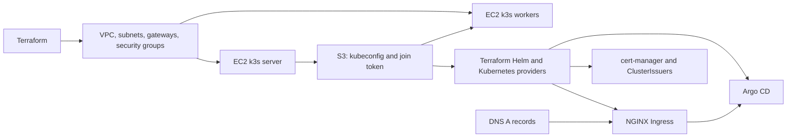

# AWS k3s Cluster with Terraform

This repository uses Terraform to build a small k3s Kubernetes cluster on AWS EC2 and install common cluster services. Despite “onprem” in the repository name, the current Terraform configuration targets AWS; it does not provision physical on-premises servers.

## What it creates

- An AWS VPC with public and private subnets across two availability zones, an Internet Gateway, and a NAT Gateway.
- One Ubuntu 24.04 k3s server (master) and a configurable number of k3s worker instances.
- An NGINX Ingress Controller, cert-manager with Let's Encrypt issuers, and Argo CD.
- An S3-backed Terraform state file, plus S3 copies of the k3s join token and kubeconfig.

The intended flow is: Terraform creates the AWS network and instances; the master install script starts k3s; workers join it; Terraform stores cluster access files in S3; then the Helm and Kubernetes providers use that kubeconfig to install the add-ons. The Argo CD Ingress is applied separately after DNS is configured.



## Requirements

- An AWS account and credentials with permission to manage the resources above.
- An existing S3 bucket named `terrformstate-060647991200` (the spelling is intentional in the current configuration). It is used for Terraform's remote state and the cluster access files.
- Terraform 1.16.5 to match the GitHub Actions workflow, AWS CLI credentials, and local `ssh`/`scp` commands available on the machine running Terraform.
- A DNS name for Argo CD and an email address for Let's Encrypt. DNS must point to the NGINX LoadBalancer address before requesting the production certificate.

## Configure and deploy

The AWS provider uses the standard AWS credential chain. Locally, configure credentials with your usual AWS method (for example, `aws configure`). Set any values you want to override from [variable.tf](variable.tf), such as worker size/count, hostname, and certificate email. For example:

```bash
export TF_VAR_worker_count=2
export TF_VAR_argocd_hostname=argocd.example.com
export TF_VAR_letsencrypt_email=admin@example.com
```

In PowerShell, set the same variables with `$env:TF_VAR_worker_count = "2"` and so on. Initialize and validate the configuration:

```bash
terraform init
terraform fmt -check -recursive
terraform validate
```

The Terraform provider configuration reads the kubeconfig from S3, which is produced only after the master is provisioned. On a fresh deployment, Terraform cannot configure the Kubernetes providers for a full plan until that kubeconfig exists. Use a bootstrap plan/apply for the AWS cluster resources first, then run a normal full plan/apply for the add-ons; see [README-TECHNICAL.md](README-TECHNICAL.md) for the target commands. Review each plan before applying; AWS resources incur charges.

After deployment, use `terraform output` for the master and worker IPs, SSH commands, kubeconfig location, NGINX address, and Argo CD URL. Configure the required DNS A record(s) to point at the NGINX address, then apply the Ingress manifest as described in [README-TECHNICAL.md](README-TECHNICAL.md). The hostname in that manifest must match the configured `argocd_hostname`.

## Important operational notes

- This is a learning/lab configuration. Several inbound rules allow traffic from `0.0.0.0/0`, including SSH and the Kubernetes API. Restrict these rules before using the cluster with sensitive workloads.
- Although private subnets and a NAT Gateway are created, the current master and workers are attached to public subnets. The NAT Gateway path is therefore not used by those instances.
- The GitHub Actions workflow currently runs initialization, formatting, and validation only. Its apply and destroy steps are commented out; a push to `main` does not currently deploy or destroy the cluster.
- Do not commit `*.pem`, `node-token`, `kubeconfig`, Terraform state, or variable files containing secrets. These paths are excluded by [.gitignore](.gitignore).

For a file-by-file explanation, Terraform dependency flow, CI behavior, and the current configuration caveats, see [README-TECHNICAL.md](README-TECHNICAL.md).
